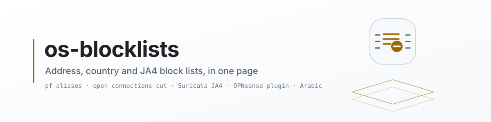

<picture>
  <source media="(prefers-color-scheme: dark)" srcset="docs/images/readme/banner-dark.svg">
  <source media="(prefers-color-scheme: light)" srcset="docs/images/readme/banner-light.svg">
  
</picture>

<p align="center">
  <a href="https://github.com/AbdelmonemAwad/os-blocklists/releases/latest"></a>
  <a href="https://github.com/AbdelmonemAwad/os-blocklists/actions/workflows/checks.yml"></a>
  <a href="LICENSE"></a>
  <a href="#what-is-tested"></a>
  <a href="https://github.com/AbdelmonemAwad/opnsense-arabic"></a>
  <a href="https://github.com/AbdelmonemAwad/os-xgs-npu"></a>
  <br>
  <a href="#what-is-tested"></a>
  <a href="#what-is-tested"></a>
  <a href="#what-is-tested"></a>
</p>

# Block Lists for OPNsense

Block lists in one place: addresses, DNS names, UT1's web categories, countries and JA4 fingerprints of TLS clients, gathered into one page - and on a Sophos XGS ~~cut by the coprocessor in hardware~~ a cut connection dropped on the coprocessor at once where os-xgs-npu's "Cut in hardware" is on and outbound is blocked too, and else taken out of it with its state (the coprocessor holds no address list of its own to block by - os-xgs-npu's hardware-drop research, issue 519).

> ~~**Planned - nothing here runs yet.** This repository was opened on 2026-10-22 to hold
> Block Lists as a plugin of its own. No code has been written or moved into it, and there is no
> release.~~
>
> ~~**Written, not released (2026-10-22).** The code is here; there is no release, and it has not been
> installed on an appliance yet. What was run is listed under [What is tested](#what-is-tested).~~
>
> **1.0.1 (2026-10-30):** a list chosen again cuts what it names, only its own aliases taken for its own, a JA4 watch over the whole minute, and a removal that leaves nothing running. ~~Tested in qemu on OPNsense 26.7.7 before the release; see~~ Tested in part before the
> release, in qemu on OPNsense 26.7.7 from the branch that became it; what ran and what did not
> is under [What is tested](#what-is-tested).
>
> **1.0.0, the first release (2026-10-25).** Installed and its page opened on an XGS 3300 (OPNsense
> 26.7.7) before the release; ~~no list has been applied through it yet~~ - since, on 2026-10-29 in
> qemu, three lists were applied through it, open connections cut, and a TLS connection cut by its
> JA4 fingerprint (see [What is tested](#what-is-tested)). Updated from XGS: Updates when os-xgs-npu
> is installed, or by its own self-update - see [Updates](#updates).

<p align="center"><b>Contents:</b> <a href="#what-it-does">What it does</a> &middot; <a href="#beside-os-xgs-npu">Beside os-xgs-npu</a> &middot; <a href="#not-yet-and-why">Not yet, and why</a> &middot; <a href="#what-is-tested">What is tested</a> &middot; <a href="#installation">Installation</a> &middot; <a href="#updates">Updates</a> &middot; <a href="#where-it-fits">Where it fits</a> &middot; <a href="#licence">Licence</a></p>

## What it does

**Firewall: Block Lists** (XGS: Block Lists when os-xgs-npu is installed), one page:

- **address lists** - chosen from a short catalogue of public feeds (`feeds.json`), each answered
  `200` and read as addresses on 2026-10-22: Spamhaus DROP (IPv4 and IPv6), abuse.ch Feodo Tracker,
  Emerging Threats compromised hosts, CINS Army, blocklist.de. Each becomes a URL Table alias of its
  own, `blocklists_<id>`, with counters on, fetched by OPNsense again every two hours by default
  (below). And since 2026-11-17 ThreatFox's command-and-control addresses, which the plugin fetches
  itself with an abuse.ch Auth-Key of the owner's (**ThreatFox**, below);
- **how often the lists are fetched** - "Fetch the lists": every 2 hours (the default), 6, 12 or 24,
  and for each list no more often than the floor kept for it in `feeds.json` (`min_hours`):
  Spamhaus DROP and DROPv6 once a day (Spamhaus's DROP FAQ); Feodo Tracker every 15 minutes at the
  most, a floor of this plugin's own (abuse.ch generates it every 5 and recommends fetching it at
  least every 15: no limit of its own); blocklist.de every 30 minutes at the most (it is generated
  that often); Emerging Threats and CINS Army, which publish no rule, once a day. So with the default, Feodo Tracker and
  blocklist.de are fetched every two hours and the others once a day. The longer of the two is written into the alias's `updatefreq`, in
  days with a fraction as OPNsense 26.7 takes it (0.083333 for two hours; OPNsense's alias updater
  checks every minute and takes anything under a second for never, which nothing here comes near).
  A list is fetched at once, whatever its floor, when its alias is made again: the list chosen
  again, or the plugin or the alias switched off and on. Until 2026-11-16 every list was fetched
  once a day; an alias made before takes the new frequency at the plugin's next Apply, which writes
  it into every alias it owns, and at every install or update of the plugin - by a package, XGS:
  Updates, the self-update or `install/install.sh` by hand: both installers run
  `fetch-frequency.php`, which sets the `updatefreq` of each alias of the plugin's own lists that is
  switched on and a URL table, where it is not what the settings say, and changes nothing else - no
  alias added, removed, switched on or off, nothing else of one rewritten; the countries' alias, one
  switched off and the owner's own are left as they are. config.xml is saved only when one changed,
  and what it did is in the system log (`blocklists`) and the installer's output (until 2026-11-17 a
  package ran the whole Apply instead, its output thrown away, and an update from XGS: Updates ran
  nothing). ThreatFox's list is no URL table, and none of this is its: it keeps abuse.ch's pace (next);
- **ThreatFox, with an abuse.ch Auth-Key** (since 2026-11-17) - "ThreatFox: command-and-control
  addresses" in Address lists: the command-and-control servers of malware that abuse.ch's ThreatFox
  holds, those of the last six months (it expires older ones), as addresses. Since 2025-06-30 abuse.ch
  serves ThreatFox's exports only with an Auth-Key of the user's own, from a free account at
  auth.abuse.ch (in its profile, under Optional); it goes in the setting **abuse.ch Auth-Key**.
  Without a key the list is not made - Apply says so - and nothing is fetched; Feodo Tracker is as it
  was. No URL table can fetch it (the key in the address, a zipped CSV, `ip:port` entries), so the
  plugin's `threatfox.py` does, into an external alias, `blocklists_threatfox` (OPNsense's "External
  (advanced)": OPNsense declares its table and leaves its addresses to the script, which puts the
  list into it with `pfctl -T replace -f -`, the list on stdin, whenever the table does not hold it -
  after a reboot too, without a fetch). It is marked `"c2"`, so it has the "from inside" rule below
  and os-netreport's alert as Feodo Tracker has.
  - *What is taken*: of an export, the indicators of type `ip:port` with the threat `botnet_cc` only,
    as addresses, IPv4 and IPv6, each once. A line that is not one is dropped, and so is an address
    no server on the internet has - private, shared (100.64/10), loopback, link-local, multicast,
    reserved, unspecified, IPv4-mapped, unique local - which blocked both ways could cut the firewall
    off its own networks. The confidence ThreatFox gives an indicator is not looked at.
  - *What is sent to abuse.ch*: the key, in the address of each download -
    `https://threatfox-api.abuse.ch/v2/files/exports/<key>/full.csv.zip` and `.../recent.csv`, as
    abuse.ch's export page asks - over HTTPS with the server's certificate checked, and a User-Agent
    of `os-blocklists`; abuse.ch sees the request come from the firewall's public address, as any
    server does. Nothing else: no address of its networks, no log, no count, no setting.
  - *Where the key is*: in config.xml - and so in its backups and in System: Configuration: History,
    as the other secrets OPNsense keeps are - and nowhere else: not on the page, whose field says only
    "saved" or "not set" (the settings' answer has it empty: OPNsense's write-only field), not in the
    system log, the script's answer or its files, not on a command line or in a configd parameter. A
    text that would carry it, an error naming the address, has it taken out first. An empty field
    keeps the key; **Remove the key**, beside it, takes it out of config.xml, and Apply then removes
    the list.
  - *Its pace, and why*: abuse.ch's Terms of Use give no number - export volumes as reasonably
    expected for non-commercial or non-profit purposes, and no high-volume automatic harvesting - but
    its API changelog of 2026-11-12 does for each export whose name holds "full": up to four times its
    size per account and UTC day, partial and cancelled downloads counted, then 429 until 00:00 UTC;
    and it asks for each full export once a day and the matching recent export for the updates in
    between. So the whole export, `full.csv.zip`, is fetched once a day - 24 hours after the last one
    fetched, and no more than twice begun in a UTC day, a download that broke off included: half of
    abuse.ch's cap, which is the account's, shared by every firewall and tool that uses it. The recent
    additions, `recent.csv`, are fetched as often as "Fetch the lists" says - every two hours by
    default - and never more often than once an hour (`min_hours` in `feeds.json`); the whole export
    takes the place of the recent additions fetched before it. A fetch that failed waits as long
    before its next try; one answered 429 waits for the time abuse.ch gives (`Retry-After`; 00:00 UTC
    without one); after a refused key (401, 403) nothing is sent for a day, or until the next Apply,
    which tries again at once, for a key just replaced. A cron entry runs the script every five
    minutes, and it fetches only what is due; the page's Apply runs it too, in the background.
  - *On a failure* - a download that fails or breaks off, an answer that is not an export, a whole
    export with no command-and-control address in it - the last good list is kept, in pf and in
    `/var/db/os-blocklists/threatfox`. The Lists tab's "ThreatFox:" line says what the list holds and
    from when, and what failed last.
  - *Commercial use*: abuse.ch's Terms of Use say that companies and others with commercial needs
    may need a paid subscription for ThreatFox; that is between the owner of the key and abuse.ch.
- **countries** - one GeoIP alias, `blocklists_countries` (it needs a GeoIP source in Firewall:
  Aliases);
- **the block rules** - registered by the plugin at every filter reload (`plugins.inc.d/blocklists.inc`,
  as os-crowdsec does): inbound from a listed address, and by default outbound to one, on every
  interface, before the interface rules. They are never added to the owner's own rules, so turning
  the plugin off or removing it leaves nothing there;
- **a device reaching a command-and-control list, logged by its own address** - a list marked
  `"c2": true` in `feeds.json` (Feodo Tracker and ThreatFox) gets one more rule while outbound is blocked
  (Both ways): `block in log quick` from any to `<blocklists_<id>>`, on the inside interfaces -
  those with an address of their own (a static IPv4 address, or IPv6 static, tracked or by identity
  association) that no gateway names (none in System: Gateways, switched off or not, IPv4 or IPv6,
  and none chosen in the interface's own gateway rules), that take no address from outside (DHCP,
  PPPoE, PPTP, L2TP, PPP, DHCPv6, SLAAC, 6rd, 6to4, PPPoEv6, lease or not) and are not virtual (the
  loopback, a VPN or interface group; one left out is under [Not yet, and why](#not-yet-and-why)) -
  described `Block Lists: blocklists_<id> from inside`, logged whatever "Log blocked packets" says,
  and before the list's other rules (all are priority 1, and OPNsense 26.7 writes one priority's
  rules in the order they were registered). It is never on a WAN, so nothing that comes in from the
  internet is blocked or logged by it. On an inside interface it comes before every other rule, the
  anti-lockout rule too (priority 5: the GUI, and SSH where it is on, passed to the firewall from the
  LAN): should the firewall's own public address be on the list - an address that served a command
  server once and was handed on - a device inside that reaches that address, the GUI opened by the
  firewall's public name or a port forward through NAT reflection, is blocked and logged as from
  inside as well; the GUI is still reached by the firewall's inside address. pf has no one rule for
  "to the list but not to this firewall", so that case is left as it is. Why the rule: the outbound
  rule matches where a packet leaves the firewall, after outbound NAT, so behind NAT its log line
  names the firewall's WAN address, never the device (seen on an XGS 3300, 2026-11-16); this one
  matches where the packet comes in from the LAN, before NAT, and its line carries the device's own
  address - os-netreport's command-and-control alert reads it by that description. It writes one
  line to the filter log for every packet it blocks, about 220 bytes (270 for TCP), and keeps no
  state, so an infected device that retries all day grows the log
  by that much each try: at one try a second about 23 MB a day, kept 31 days by OPNsense's default;
- **open connections cut** - a block rule stops new connections only; with "Cut open connections"
  on, a connection already open to or from an address a list has just gained is cut within a
  minute (`cut.py`), and on a Sophos XGS taken out of the coprocessor with its state - or, where
  os-xgs-npu is installed with its "Cut in hardware" on and the lists block outbound too (Both
  ways), dropped on the coprocessor first (below);
- **JA4** - TLS connections whose client shows a listed fingerprint are cut, read from the
  Intrusion Detection's TLS log every two seconds (`ja4_cut.py`); the page lists the fingerprints
  seen, to find the one to list (those in the log's last 64 MB, since 2026-10-29);
- **DNS lists** - OPNsense keeps them itself, in Unbound DNS: Blocklists; the page shows them beside
  the others and links there;
- **web categories** (since 2026-11-19, not yet on a firewall: [What is tested](#what-is-tested)) - the
  categories of web sites of UT1, Université Toulouse 1 Capitole (its blacklists: gambling, phishing,
  proxies, advertising and some sixty more), chosen on the **Web categories** tab and blocked by DNS:
  - *Through OPNsense's own Unbound blocklist, the owner's settings untouched.* The plugin puts a
    handler, `blocklists_ut1.py`, beside OPNsense's own in `/usr/local/opnsense/scripts/unbound/blocklists/`,
    as Deciso's os-q-feeds-connector does with its own. OPNsense's `blocklists.py` (`configctl unbound
    dnsbl`) runs every handler there and merges what each gives into `/var/unbound/data/dnsbl.json`,
    which Unbound reads within a minute, without a restart. The handler gives one policy of the plugin's
    own beside the owner's: no setting or policy of Services: Unbound DNS: Blocklists is added, changed
    or shown there. The policy is for every client (no source network) and answers as a policy of
    Unbound DNS: Blocklists answers by default: `0.0.0.0`, with NOERROR - not NXDOMAIN. A name of UT1's
    means that name and every name under it, so each is given as a wildcard entry; a name two chosen
    categories hold is held once. The handler reads only what the plugin wrote, never stops OPNsense's
    update (a file missing or unreadable is left out, the rest given), and gives nothing once the plugin
    is off or removed.
  - *Where they come from, and their licence.* Each category is fetched by the firewall itself, over
    HTTPS with the server's certificate checked, from
    `https://dsi.ut-capitole.fr/blacklists/download/<category>.tar.gz`; the lists are UT1's, under the
    Creative Commons licence [CC BY-SA 4.0](https://creativecommons.org/licenses/by-sa/4.0/), credited on
    the page with a link to the licence. This project republishes none of them. The categories offered
    are those of `categories.json`, shipped with the plugin - each with a label and a description in this
    project's own words, UT1's default use (block or allow list) and its names, counted on 2026-11-19
    from each category's `domains` file - and those UT1's own catalogue, `global_usage`, adds where it can
    be read: the plugin fetches it once a day while a category is chosen. On 2026-11-19 UT1's site,
    under maintenance, answered its maintenance page for `global_usage` (the archives were served), and
    that page is not taken for a catalogue. Malware and phishing are one archive at UT1, the same file
    under its folder `phishing/`: chosen together, they are fetched once and held once.
  - *How big each is.* The page shows each category's names and the memory they would take in Unbound:
    an estimate, at about 527 bytes a name - measured with OPNsense's own code on a PC in phase 0, not on
    a firewall. The largest on 2026-11-19: Phishing and Malware 241,045 names (~121 MiB), the three
    Proxies 109,793 each, the same names (~55 MiB), Gambling 95,180 (~48 MiB), Job search 60,740
    (~31 MiB), Shopping 36,964 (~19 MiB), Games 33,715 (~17 MiB); most hold a few thousand or fewer.
  - *Adult is left out*: about 4.6 million names (UT1's own page, 2026-10-08), about 2.3 GiB held by
    Unbound's module - too much for a firewall. The page shows it greyed, with that reason; the model
    does not offer it, and `categories.py` and the handler refuse it whatever config.xml says. Any
    archive of more than a million names is refused too.
  - *Fetched as the lists are.* `categories.py` runs from cron every five minutes and checks each chosen
    category with UT1 as often as "Fetch the lists" says - every two hours by default - with
    If-Modified-Since (and If-None-Match where UT1 gives an ETag): unchanged, UT1 answers 304, which
    costs nothing and changes nothing. A changed one is unpacked - of the archive only its
    `<category>/domains` member, by that name, a plain file and only one, nothing written where the
    archive says; its names are written, lowercased and each once, into
    `/var/db/os-blocklists/categories/<archive>.domains`, and its bare IPv4 lines left out, as DNS
    cannot use them - and Unbound's blocklist is rebuilt once a run, only when something the handler
    reads changed. The page's Apply runs it at once, in the background. A download that fails keeps the
    last good copy, and the tab says so; a category no longer chosen, or Block Lists turned off, is taken
    out at the next run. With none chosen the script contacts no one and writes nothing.
  - *Exceptions.* Names let through, each with every name under it: written into the policy's passlist
    as `(.*\.)?<name>$`, as Unbound's module matches it from the start of the name asked for, so
    `example.com` lets `www.example.com` through and not `example.com.evil.net`; a name an exception
    covers is not given to Unbound at all. As an allowlist in Unbound DNS: Blocklists does for its own
    policy, they apply to this plugin's policy only.
  - *Without Unbound.* Where Unbound DNS is off, the tab says the categories have no effect; nothing
    breaks, and they apply once it is on.
- **Lookup** (since 2026-11-19) - a name or an address in, every place of these lists that holds it out
  (`lookup.py`, read only): for an address, each of the plugin's pf tables that holds it (`pfctl -t
  <table> -T test <address>`); for a name, the web categories applied that hold it or a name above it,
  with the exception that lets it through, and Unbound's own blocklist data - `dnsbl.json`, searched where
  it lies, never loaded whole - each entry for the name, or for a name above it where that entry is a
  wildcard one: for the web categories' policy, the entry and whether an exception lets the name
  through; for a policy of Unbound DNS: Blocklists, only that it holds the name, and its description -
  not its networks, its lists, its entries or its allowlist, since the tab is open to whoever may see
  Block Lists, who need not be allowed to see Unbound's settings. A name is not resolved, and not looked
  up in pf's tables, which hold addresses. What is looked up is checked twice before anything runs - by the page's controller and by
  the script: a host name, or an IPv4 or IPv6 address, nothing else.

~~a page in the XGS section of OPNsense's menu~~ - it is under **Firewall**, beside Aliases and Rules
(under **XGS** when os-xgs-npu is installed): it writes the one and adds to the other, and it is not
for XGS appliances only.

FireHOL's level 1 is left out of the catalogue on purpose: it carries the private networks
(RFC 1918's 10/8, 192.168/16 ...), and blocked both ways it would cut a firewall off its own LAN.

The `blocklists_` prefix is reserved for the plugin: it makes and owns `blocklists_<id>` for each list
of `feeds.json` and `blocklists_countries`, and an alias of the owner's by one of those names is
rewritten or removed by its next Apply; one by another `blocklists_` name is left alone (until
2026-10-29 every `blocklists_*` alias was blocked, cut and removed as the plugin's).

## Beside os-xgs-npu

`cut.py` and `ja4_cut.py` came from os-xgs-npu (`scripts/xgs/lists_cut.py`, `scripts/xgs/ja4_cut.py`),
which has not been changed: they still run where it is installed, for the lists and fingerprints
XGS: Settings names. Here, a list or a fingerprint named there is left to os-xgs-npu, so nothing is
cut twice; everything else is this plugin's.

**Cut in hardware too** (since 2026-11-16). Where os-xgs-npu is installed
(`/usr/local/opnsense/scripts/xgs/hwdrop.py` is there), `cut.py` and `ja4_cut.py` call its hardware
drop before they kill the pf states, as its own `lists_cut.py` and `ja4_cut.py` do: `cut.py` once a
run with every list's new entries (`hwdrop.drop_addresses`), `ja4_cut.py` once a reading with each
cut state's ends and protocol (`hwdrop.drop_ends`). With XGS: Settings "Cut in hardware" on, the
coprocessor drops those connections at once, both ways, and keeps them dropped while their senders
go on sending (they leave it about 20 seconds after their frames stop, as os-xgs-npu measured); off,
or with no driver table, it drops nothing and says 0. `cut.py` drops in hardware only while the lists
block outbound too (Both ways): under Inbound only the rules let such a connection out, and it would
stay dead on the coprocessor - its pf state is killed as before, and the connection made again goes
through. A connection dropped there is handed back to the host when its address leaves every watched
list - an entry a list loses, a list unchosen or no longer watched, the plugin turned off - by
`hwdrop.release_addresses` (os-xgs-npu since 2026-11-17), at the next run of `cut.py`; pf then decides
its frames again. An entry another watched list still holds is left as it is, and a hand-back left at
its deadline is tried again at the next run. With an os-xgs-npu older than that, it is not handed back
by address: it ends when its sender stops, or is handed back on XGS: Offloaded Flows. The hardware
step has 5 seconds, and they are a hard limit (since 2026-11-17): it
runs in a thread of its own, and at 5 seconds the pf cut goes on whatever the step is doing. The step
is told to stop and ends at the next connection it looks at, writing no verdict after that - or, if
a call into the driver never returns, with the process. How many it dropped is then not known, and
the summary, the message and the system log say "unknown". The flow-table lock it may hold goes
with the process; the page place it shares with os-xgs-npu's other readers is put back by the step
as it ends, or, if the process ends first, stays until the next reading puts it back. While a step
left at its deadline still runs, no second one is started beside it (`ja4_cut.py` reads every two
seconds). Before, a real-time timer stopped the step, and the pf cut could wait well past the 5
seconds for a driver call to end. The module is loaded from os-xgs-npu's place, not copied, and only
when there is something to cut; the count is in the summary, the page's "Open connections" line (for
`ja4_cut.py`, the JA4 tab's "Last run" line) and the system log (`N connections dropped in
hardware`). Without os-xgs-npu nothing changes.

## Not yet, and why

- **a QUIC or DTLS client's JA4** - only a TLS client over TCP (`t...`) is cut: `ja4_cut.py` reads
  the Intrusion Detection's `tls` lines, and a QUIC (`q...`) or DTLS (`d...`) client's fingerprint
  is not among them. Since 2026-10-29 the field takes `t` fingerprints only; before, such a one was
  taken and never matched.
- **the command line's apply writes the aliases only** - `configctl blocklists apply` is the first
  step of the page's Apply, which then reloads the filter (`configctl filter reload skip_alias`), its
  template (`configctl template reload OPNsense/Filter`) and the aliases (`configctl filter
  refresh_aliases`), and runs the cuts once (`configctl blocklists cut`, `configctl blocklists ja4`).
  From a shell, run those after it, as the tests below did.
- **a fingerprint listed as the Intrusion Detection begins to log JA4** is watched from the next
  minute: until then the minute's watch has found nothing to read and ended. Listed while the
  Intrusion Detection already logs JA4, it is watched within two seconds - since 2026-10-29 the watch
  goes on through the minute with nothing listed; before, a fingerprint listed during the minute waited
  for the next one. Not yet tested.
- **a LAN with a router behind it has no "from inside" rule** - an interface a gateway is on is not
  taken for inside, so a LAN whose router to further inside networks is a gateway in System:
  Gateways is left out too. OPNsense 26.7's "Upstream Gateway" mark cannot tell that router from a
  WAN's gateway: it is off unless ticked, a WAN on DHCP never has it, and a gateway without it still
  becomes the default route when no marked one is up. The test is this wide because the narrower one
  before it, the filter's own gateway for each interface, took a WAN for inside until 2026-11-17 -
  one whose gateway rules are Disabled, whose gateway is switched off or left to auto-detect, or one
  on DHCP without its lease and with a static IPv6 address - and the rule then blocked what came in
  on it to the firewall's own address, were that address listed. That LAN's devices are still
  blocked by the outbound rule; they are logged only as "Log blocked packets" says, and behind NAT by
  the firewall's WAN address.
- **the aliases outlive the plugin** - removed, it leaves them in Firewall: Aliases, blocking nothing,
  and OPNsense goes on fetching their lists; turn Enabled off and Apply before removing it
  ([Installation](#installation)).
- **no list is dropped in an XGS's hardware** - the coprocessor holds no address list of its own to
  block by (os-xgs-npu's hardware-drop research, issue 519); a cut connection is taken out of the
  coprocessor with its state, and with os-xgs-npu's "Cut in hardware" on and outbound blocked too
  (Both ways) it is dropped there first ([Beside os-xgs-npu](#beside-os-xgs-npu)) - a connection,
  not the list.

- **web categories are DNS only** - a client that asks another resolver than the firewall's Unbound, or
  uses DNS over HTTPS or over TLS, is not filtered by them (the category DNS over HTTPS lists public
  DoH services, to block that way round), and neither is a connection made straight to an address, HTTPS
  by IP among them. UT1's `urls` and `expressions` are not used: DNS cannot. The categories are UT1's,
  as UT1 publishes them, and are not checked here; UT1 asks that its categories be chosen, not all
  blocked at once. One policy for every client: per network and per user it is phase 4 (top-04).
- **an exception can let a name through an owner's broader wildcard** - Unbound's module decides at the
  first entry it meets, the name's own first and then each name above it: where a category holds
  `www.example.com`, an exception is `a.www.example.com` and one of the owner's policies holds all of
  `example.com`, the category's entry and its exception let `a.www.example.com` through before the
  owner's is reached. That is OPNsense's matching; a name an exception covers is not given to Unbound,
  which keeps every other case to the owner's policies.
- **the memory a category takes** is an estimate from a PC; the largest category allowed is to be
  measured on a firewall.

## What is tested

On the second XGS 3300, 2026-10-22, from a copy in `/tmp`, nothing installed and config.xml not
written:

- every PHP file and the rules hook pass `php -l`; both Volt templates compile;
- `status.py` reads the configuration and pf's tables: no list chosen, the catalogue, Unbound;
- `cut.py` (its state pointed at `/tmp`): "no list watched";
- `ja4_cut.py`: its settings read ("Intrusion Detection is off" there), and `--seen` listed the
  fingerprints in the log, the most frequent first;
- the rules hook, called as a filter reload calls it: no rule, as no list was chosen.

On the first XGS 3300, 2026-10-25, OPNsense 26.7.7 with os-xgs-npu installed, before the release:

- installed by `install/install.sh`: rc 0, its PHP passing `php -l` in the installer;
- the page opened in the browser, its summary cards reading the status;
- its menu place: under **XGS** with os-xgs-npu installed; in its own section, **Firewall**, when
  os-xgs-npu's menu file was set aside, and back under XGS when it was put back (`place-menu.sh`).

On a plain OPNsense 26.7 in qemu, 2026-10-29: the nano image with nothing of os-xgs-npu on it, its
WAN reaching the internet. Three lists - Spamhaus DROP, Feodo Tracker and CINS Army - were chosen
through the plugin's model and applied with `configctl blocklists apply`, then the filter was
reloaded and the aliases refreshed.

- **The package.** `os-blocklists-1.0.0.pkg` and `SHA256SUMS` were fetched from the release and the
  sum checked OK. `pkg add` returned 0, and the page is under Firewall > Block Lists.
- **The aliases.** apply answered `blocklists_spamhaus_drop: added`, `blocklists_feodo: added` and
  `blocklists_cins_army: added`, and all three are in config.xml.
- **The lists fetched.** OPNsense filled the tables: CINS Army with 15,000 entries, Spamhaus DROP
  with 1,758 and Feodo Tracker with 1, the day's list.
- **The rules.** pf holds `block drop in quick inet from <blocklists_...>` and `block drop out quick
  inet from any to <blocklists_...>` for each list.
- **A cut.** Three states were open to the host's web server. Its address was added to the Feodo
  table, as a list gaining it would, and `cut.py` was run: it found 1 new entry and cut the 3 open
  connections, and none were left. The log reads `blocklists_feodo: 1 new entry of 2, 3 open
  connections cut`.

On two ~~such~~ machines in qemu the same day, plain OPNsense 26.7.7 - the first updated from 26.7 -
the second a copy of the first, joined by a cable of
their own. Intrusion Detection ran on the first in IDS mode, only listening, on that cable, its eve
TLS log carrying the JA4 field. It was set through its own model and applied as its page's Apply
does (the template, the rules installed, the service started). The second machine opened TLS
connections to the first one's web server.

- **The fingerprints seen.** `ja4_cut.py --seen` listed two from the second machine: `fetch`'s,
  over three connections, and `openssl s_client`'s, over one.
- **A JA4 cut.** A TLS connection was held open by `openssl s_client`, its request sent 12 s after
  the handshake. Not listed, it was answered (`HTTP/1.0 200 OK`). Then s_client's fingerprint,
  `t13d301100_1d37bd780c83_8e6e362c5eac`, was listed through the plugin's model and the page's
  Apply. The next such connection was cut 2 s after its handshake by the job that reads the log
  every two seconds - the system log names the fingerprint and the connection, `cut (1 state)` -
  and its request was never answered. Once the fingerprint was removed and applied again, the
  connection was answered again.

Not tested: ~~`apply.php` writing the aliases (it saves config.xml), the rules with lists in them,
the lists fetched, a cut~~ (on 2026-10-29 in qemu, above), ~~a JA4 cut through this plugin~~ (on
2026-10-29 in qemu, above), ~~the page in a browser~~ (opened on 2026-10-25, above), ~~the package
(built by `tools/make-package.sh`, added with pkg), and an install on a plain OPNsense, without
os-xgs-npu~~ (on 2026-10-29 in qemu, above). ~~The JA4 cut needs Intrusion Detection running with
its TLS log, which was not set up here.~~ It was, on a second machine's connections (above).

Written after the tests above and ~~not yet tested~~ (2026-10-29), and tested in part that evening,
below: only the plugin's own alias names
taken for its own; a list watched again cutting what it names, and its snapshot written only when
its table changed; the JA4 watch going on through the minute with nothing listed, the log read a
line at a time, and the field taking `t` fingerprints only; the checks before the copy; and the
removal's stopping of a running cut, its deleting of the state and its emptying of stale tables.

1.0.1's branch, run on 2026-10-29 in qemu on OPNsense 26.7.7, before its release commit, with the
second machine's connections:

- **Only its own aliases.** An alias the plugin does not own, beside its own: after the rules hook
  and after Apply it was still in config.xml, and no block rule named it.
- **A list chosen again.** Feodo, unwatched and watched again: `blocklists_feodo: 1 new entry of 1,
  0 open connections cut` - no connection to its address was open, so there was nothing to cut.
- **JA4 through the minute.** With nothing listed the watch went on running, at 19:49:00 and again at
  19:49:25; a fingerprint listed in the middle of the minute was cut at once, its one state with it.
  Apply's own answer just after the listing still read `cut by TLS fingerprint: no fingerprint
  listed`.

On the second XGS 3300 on 2026-11-16 (22:00-22:12 UTC), Feodo Tracker chosen with its log on and the
general logging off: the inside rule first among the plugin's and logged; a connection from the XGS
136 behind it to a test address put into Feodo's table blocked where it came in, the line naming the
136's own address, not the WAN's; os-netreport's alert and its infected.json entry from it. That day
Feodo Tracker held one address (phase 0's reading), so the rule rarely fires. The rule was floating
then; on the inside interfaces only (none a gateway is on, none on DHCP or the like, none virtual),
the hardware drop's Inbound only and deadline, and the fetch frequency written at an install or
update (`fetch-frequency.php`), are to be run on a firewall before this is merged.

Its table drives os-netreport's alert and os-portguard's isolation: OPNsense fetches an alias's URL
without checking the server's certificate unless "Check certificate of aliases URLs" is on
(Firewall: Settings: Advanced), and takes any answer of the server's as the list - turn it on where a
command-and-control list is chosen. ThreatFox's list is fetched by the plugin itself, the server's
certificate always checked, and an answer that is not an export is never taken for one.

ThreatFox (2026-11-17) is tested by the checks only - not on a firewall, and not against abuse.ch,
which needs a real key. `tools/test-threatfox.py` reads a recorded sample of ThreatFox's CSV export,
made up from documentation addresses, and runs `threatfox.py` with stand-ins for abuse.ch's server,
pfctl and the system log: the export read zipped or not, by the line naming its columns or by their
places; abuse.ch's pace over two days; 401, 403 and 429, an empty or broken file, a download cut off,
too large or too slow, pfctl refusing the list - the last list kept; the key unset, the list not
chosen, its alias missing - nothing sent; a reboot - the table filled again without a fetch; the key in
no answer, file or log line. `tools/test-threatfox.php` runs apply.php's alias and Remove the key with
OPNsense's classes stood in for, `tools/test-status.py` the page's line and the key's field, and
`tools/test-rules.php` its rules. Each part was undone or broken in a copy of the tree, and a test
failed for each (71 mutations). To be run on a firewall before this is merged: the page and its key
field, a real key, the two exports' names and layout as abuse.ch serves them, the answer to a refused
key, and the table and the inside rule with ThreatFox's addresses.

Still not tested: the snapshot written only when its table changed, the log read a line at a time,
the field refusing all but `t` fingerprints, the checks before the copy, and the removal.

The web categories and the Lookup tab (2026-11-19) are tested by the checks only - not on a firewall,
and not against UT1's server. `tools/test-categories.py` runs the handler against a copy of OPNsense
26.7.9's `BaseBlocklistHandler` and of the part of its `blocklists.py` and Unbound module that merges and
matches the policies: one policy, wildcard entries, bare IPv4 lines, comments and blank lines left out,
each name once, the exceptions anchored (`example.com` passes `www.example.com`, not
`example.com.evil.net`), adult refused though the handler's file names it, a file missing, a folder or a
link left out and the rest given; and `categories.py` with a stand-in for UT1's server: an archive's
member taken by its name only (links, folders, paths that climb out, a second copy refused), the
conditional request (304: Unbound's blocklist not rebuilt), malware and phishing one download, adult
never fetched though written into config.xml by hand, the last good copy kept on a failure, a category
unchosen and Block Lists off taken out, a rebuild that did not happen tried again. `tools/test-lookup.py`
answers the plan's three - a name a UT1 category holds, an address in a listed table, a name in
nothing - and refuses shell metacharacters, a name with spaces and an empty one; `tools/test-categories.php`
runs the model's field and masks. The counts of `categories.json` were read on 2026-11-19 from the archives
UT1 served that day. To be done on a firewall before this is merged: the page, a category applied and a
name of it blocked, an exception let through, a category turned off and its names back, the Lookup tab's
three answers, Unbound's memory with the largest category allowed, and a removal leaving nothing in
Unbound.

## Installation

It is not in the OPNsense plugin repository, so there is no `pkg install os-blocklists`.

**From a checkout** of this repository, on the firewall, as root:

```sh
sh install/install.sh
```

It ~~copies `src/` onto `/usr/local` (the rules hook and the cron entry for the cuts with it), checks
the PHP and the rules hook with `php -l` and the Python with `py_compile`,~~ checks the PHP and the
rules hook with `php -l` and the Python with `py_compile` before anything is copied (since
2026-10-29: checked after the copy, a hook with an error stayed where every filter reload includes
it), then copies `src/` onto `/usr/local` (the rules hook and the cron entry for the cuts with it),
puts the page in the menu (`place-menu.sh`: XGS with os-xgs-npu, Firewall without), writes the
fetch frequency into the plugin's aliases already there (`fetch-frequency.php`, above) and records the
commit for the self-update. Safe to run again: the settings in config.xml are kept. Nothing is
blocked until lists are chosen on the page and applied. `sh install/uninstall.sh` removes the plugin
and its rules; the `blocklists_*` aliases stay in Firewall: Aliases, blocking nothing, and OPNsense
goes on fetching their lists as often as they last said.

**Before removing it**, turn **Enabled** off and **Apply** to take the aliases away as well: the
Apply removes each alias of the plugin's that nothing else names (one that a rule of the owner's
names is switched off instead). The removal itself, by the script or by pkg, stops a cut that is
running, deletes what the cuts kept in `/var/db/os-blocklists`, and empties the pf table of each of
the plugin's aliases that is gone, when no rule uses it - a table outlives its alias, and went on
holding the addresses (all of this since 2026-10-29). Since 2026-11-19 it also removes the web
categories' handler from OPNsense's folder of Unbound blocklist handlers - by its own name, never the
folder - with what Python compiled of it there, deletes the categories fetched, and rebuilds Unbound's
blocklist (`configctl unbound dnsbl`) while it still holds the plugin's policy, so nothing of the
plugin's stays in Unbound. An install or an update rebuilds it only where categories are applied, so
the handler just installed is the one read.

**From a release's package.** A release carries `os-blocklists-<version>.pkg` and `SHA256SUMS`,
built by `tools/make-package.sh` in the release workflow; ~~installing it has not been tested yet~~
it was added with pkg on a plain OPNsense on 2026-10-29 - see [What is tested](#what-is-tested).
Check it and read it before adding it, as root:

```sh
sha256sum -c SHA256SUMS
pkg info -lF os-blocklists-*.pkg       # every file it will write
pkg add os-blocklists-*.pkg
```

`pkg delete os-blocklists` takes the rules hook with the files and reloads the filter, so the rules
leave pf; the settings and the `blocklists_*` aliases stay, blocking nothing (see **Before removing
it**, above). The same package is built on the firewall from a checkout with
`sh tools/make-package.sh -o /tmp`.

## Updates

Taken by hand, to this repository's **releases**: from **XGS: Updates**, its *Plugins* tab, where an
[os-xgs-npu](https://github.com/AbdelmonemAwad/os-xgs-npu) that lists this plugin is installed - the
tab calls `/usr/local/opnsense/scripts/blocklists/self-update.py`, with `check` to ask and without
it to install - or by running that script. The plugin's cron entry runs the cuts every minute, never
the self-update; no cron entry runs that. It reads the latest release's signed manifest and, when the release is
ahead of what is installed, downloads the archive the manifest names and runs the `install/install.sh` it carries - the same
script a hand install runs. A change merged on `main` reaches an installed firewall when it is
released, not before.

- **Signed releases** (since 2026-11-07). A release is installed only as its owner signed it. It carries
  `os-blocklists-<tag>.tar.gz`, the tag's tree made by `git archive`; `release.json`, the manifest - the tag, its
  commit and date, the archive's SHA-256 and size; and `release.json.sig`, the manifest's Ed25519 signature, made by
  the owner's private signing repository, never by this repository's CI. The public keys are installed in
  `/usr/local/opnsense/scripts/blocklists/release-keys/`. A release whose signature does not verify with one of them,
  or whose archive is not the one signed, is not installed, and a release not signed is not offered. GitHub's API
  and npuforge.org's copy of it no longer choose what is installed, and the tag's commit is confirmed with GitHub
  before the download. A release is made a draft by `release.yml` and published only once it is signed.
- **Only forward.** What is installed is recorded in `/usr/local/share/os-blocklists/installed.json`
  by the installer: the commit, from a git checkout or from the `.source-commit` stamp an update
  leaves in the tree. A firewall running something newer than the release - by the date signed - is not taken back; an
  install with no commit recorded takes the latest release once.
- **A package install records no commit**, so its first self-update takes the latest release and
  installs it with `install/install.sh`, outside pkg. A package is updated with a newer package
  instead: `pkg add -f`.
- **What happened** is in the system log as `self-update`, in
  `/usr/local/share/os-blocklists/update.json`, and the installer's output in `update.log` beside it.
- `self-update.py check` says what it would do and changes nothing.

Tested by `tools/test-self-update.py`, which the checks run - releases made and signed in the test with
throwaway keys: what is taken and refused, and what an update installs - and on an XGS 3300 through the
*Plugins* tab, with seven other plugins: [the plugins' signed releases, measured](https://github.com/AbdelmonemAwad/os-xgs-npu/blob/main/docs/measurements/signed-plugin-releases-2026-11-07.md).

## Where it fits

It is one part of the [os-xgs-npu](https://github.com/AbdelmonemAwad/os-xgs-npu) project, which puts OPNsense on Sophos XGS hardware, and works the way its other plugins do: changes by pull request, a release installed from **XGS: Updates** (listed there since os-xgs-npu 0.1.0-alpha.8, and installed with the project's update since 0.1.0-alpha.8.2), its Arabic in [opnsense-arabic](https://github.com/AbdelmonemAwad/opnsense-arabic)'s catalogue.

## Licence

BSD 2-Clause - see [LICENSE](LICENSE). The lists are their publishers', under their own terms, linked
from the page; the plugin fetches them and redistributes none. The web categories are UT1's
(Université Toulouse 1 Capitole), under [CC BY-SA 4.0](https://creativecommons.org/licenses/by-sa/4.0/),
fetched by each firewall from UT1 itself; `categories.json` holds their names and sizes, and labels and
descriptions in this project's own words, not UT1's lists.
